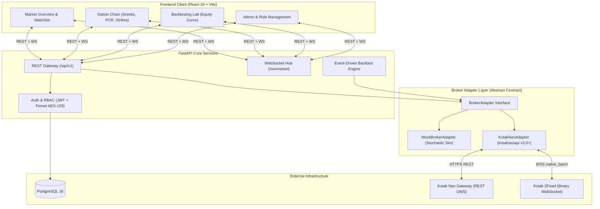
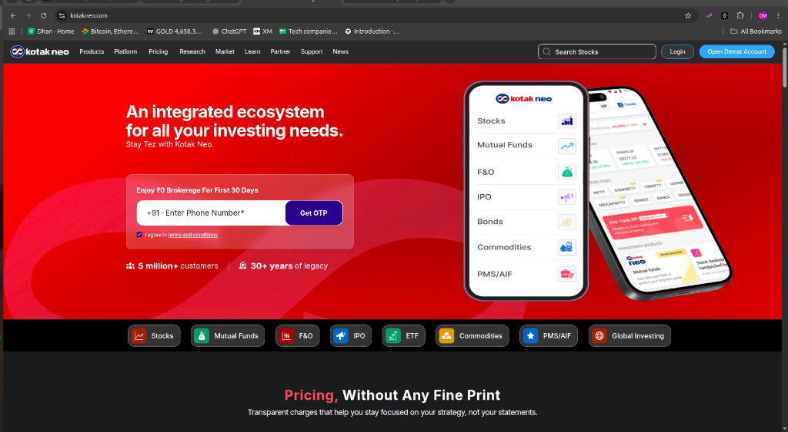
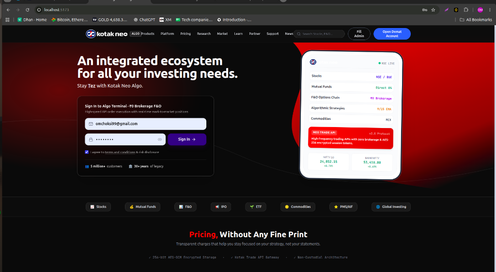
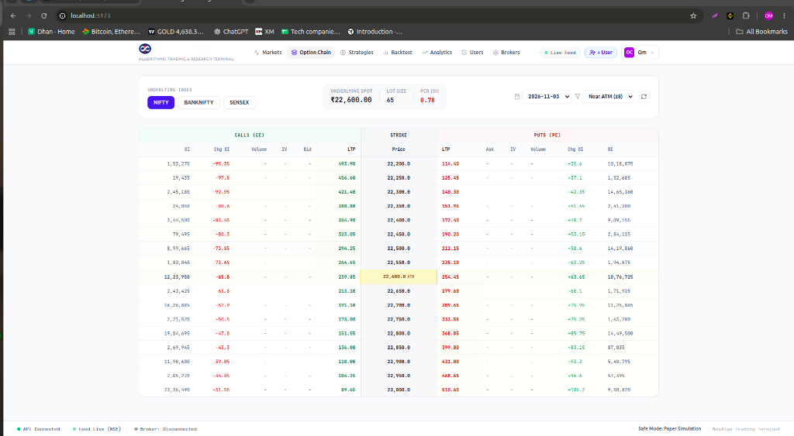
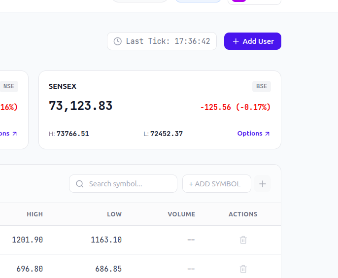

# Indian Algo Trading & Research Platform

[](https://github.com/OMCHOKSI108/kotak-neo-algo/actions/workflows/ci.yml)
[](https://fastapi.tiangolo.com)
[](https://react.dev)
[](https://www.postgresql.org)
[](https://python.org)

High-throughput, broker-agnostic algorithmic trading engine and quantitative research lab built with **FastAPI**, **PostgreSQL**, and **React (Vite + Tailwind CSS)**. Features pluggable broker adapters, official **Kotak Neo API (v3.0+)** integration, live option chains with Greeks, 2-phase RMS margin enforcement, multi-role RBAC, and a statutory-cost-aware backtesting engine.

---

## System Architecture



---

## Platform Visuals

| Live Market Overview | Real-Time Option Chain |
| :---: | :---: |
|  |  |
| **Quantitative Backtesting Lab** | **Encrypted Broker Connection** |
|  |  |

---

## Core Technical Modules

### 1. Broker-Adapter Decoupling (`BrokerAdapter`)
Trading strategies, pricing caches, and UI components interact exclusively through the abstract base contract [`server/app/broker/base.py`](server/app/broker/base.py):
* **Authentication**: `authenticate(credentials: dict) -> bool`
* **Market Ingestion**: `get_quotes(symbols)`, `subscribe_market_data(symbols, callback)`
* **Derivatives**: `get_option_chain(underlying, expiry) -> OptionChainResponse`
* **Order Lifecycle**: `place_order()`, `modify_order()`, `cancel_order()`, `get_orders()`, `get_positions()`

### 2. Kotak Neo Gateway & 2-Phase RMS Validation
Integrates directly with the official modern `kotakneoapi` SDK (post-HS deprecation):
* **Handshake Protocol**: 2-step TOTP handshake (`totp_login` &rarr; `totp_validate(mpin)`) dynamically generating session bearer tokens and dedicated binary `feedUrl`.
* **Symbol Canonicalization**: Auto-resolves cash equities to exchange format (e.g. `RELIANCE-EQ` on `nse_cm`) and derivatives to spaceless tokens (e.g. `NIFTY24DEC24500CE` on `nse_fo`).
* **Two-Phase RMS Margin Protection**:
  1. *Synchronous Pre-check*: Detects immediate SDK margin rejection (`stat: "Not_Ok"`, `emsg`).
  2. *Asynchronous RMS Interception*: When balance is ₹0.00, Kotak OMS issues an order ID but rejects within milliseconds. The adapter queries order history, detects `ordSt: "rejected"` (`rejRsn: "RMS: Rule: Check Available Margin..."`), and surfaces rejection reasons directly without phantom fills.
  3. *Funded Execution*: When available margin $\ge$ required margin, orders route to exchange with status `EXECUTED` (or `OPEN` for limit books).

### 3. Quantitative Backtesting & Statutory Cost Engine
Vectorized, discrete-event backtesting operating independently of broker connections:
* **Cost Structure**: Simulates exact Indian tax and clearing friction:
  $$\text{Friction} = \text{Brokerage} + \text{STT} + \text{Turnover Fee} + \text{SEBI Fee} + \text{Stamp Duty} + \text{GST (18\%)} + \text{Slippage}$$
* **Performance Metrics**: Calculates Sharpe Ratio, Sortino Ratio, Maximum Drawdown (₹ / %), Profit Factor, Win Rate, and tick-by-tick equity curve.

### 4. Enterprise Security & Multi-Role RBAC
* **Encryption at Rest**: Broker secrets (Consumer Keys, MPIN, TOTP secrets) are encrypted via symmetric **Fernet AES-128-CBC** (`cryptography`) before database storage.
* **Masked Display**: Keys and tokens are masked across all UI endpoints (`mask_secret()`).
* **RBAC Enforcement**:
  * `superadmin` (`omchoksi99@gmail.com`): User provisioning, role grants, global audit logs, full strategy management, and backtest suite.
  * `user`: Broker connection management, live market feed, basic metrics, and self-directed trade execution.
* **Safety Switch**: Global hardware interlock (`TRADING_ENABLED=false`) in `.env` blocks live order dispatch unless explicitly overridden.

---

## Quickstart Guide

### Prerequisites
* **Python 3.11+**, **Node.js 20+**, and **Docker** / **PostgreSQL 16**.

### 1. Database & Infrastructure
```bash
docker compose up -d
```

### 2. Backend Initialization
```bash
cd server
python -m venv .venv && source .venv/bin/activate
pip install -r requirements.txt
cp ../.env.example .env
python -m app.db.init_db
python run.py
```
* API Server: `http://127.0.0.1:8000` | OpenAPI Docs: `http://127.0.0.1:8000/docs`
* Default SuperAdmin: `omchoksi99@gmail.com` / `superadminpass`

### 3. Frontend Client
```bash
cd client
npm install
npm run dev
```
* Web Dashboard: `http://localhost:5173`

---

## Automated Verification & CI/CD

Our GitHub Actions pipeline continuously verifies every commit across 3 parallel jobs:
1. **Backend Suite**: Spins up a clean PostgreSQL 16 container, runs 42 pytest cases (auth, encryption, Kotak Neo specs, RMS margin tests).
2. **Frontend Suite**: Runs strict TypeScript checking (`tsc --noEmit`) and compiles the production Vite bundle.
3. **Docker Validation**: Syntactically checks container topology (`docker compose config`).

```bash
# Run tests locally
cd server && pytest -v --tb=short

# Run client typecheck & build locally
cd client && npm run typecheck && npm run build
```

---

## License
MIT License. Built for disciplined quantitative research and algorithmic trade execution.
